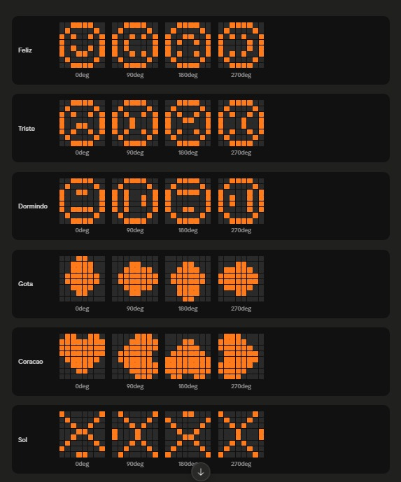

# FalaMangue 🌱

Protótipo educativo que transforma um pedaço do manguezal em um "pet": sensores medem luz, umidade do solo, temperatura, umidade do ar e a aproximação de pessoas, e uma matriz de LED 8x8 mostra como o mangue está se sentindo.

Projeto base do artigo **Mangue Interativo: prototipagem educacional orientada por um roadmap IoT & Maker**, aprovado no Congresso Senac PE 2026 (Espaço do Conhecimento).

🔗 Protótipo da interface: https://plain-detach-14896837.figma.site/

## Expressões

O mangue escolhe a expressão seguindo esta ordem de prioridade:

| Prioridade | Situação | Expressão |
|---|---|---|
| 1 | Alguém a até 20 cm | ❤️ Coração |
| 2 | Solo seco (umidade abaixo de 30%) | 💧 Gota alternando com triste ("com sede") |
| 3 | Calor extremo (35 °C ou mais) | ☀️ Sol |
| 4 | Pouca luz | 😴 Dormindo |
| 5 | Umidade do ar acima de 90% | ❤️ Coração |
| 6 | Tudo bem | 😊 Feliz alternando com coração |

## Componentes e ligações

| Componente | Pino no Arduino |
|---|---|
| LDR (luminosidade) | A0 |
| Sensor de umidade do solo | A1 |
| DHT11 (temperatura e umidade do ar) | D4 |
| HC-SR04 (ultrassônico) | TRIG D9, ECHO D8 |
| Matriz de LED 8x8 com MAX7219 | DIN D7, CLK D5, CS D6 |

## Como rodar

1. Instale a [Arduino IDE](https://www.arduino.cc/en/software).
2. Em **Ferramentas → Gerenciar Bibliotecas**, instale **DHT sensor library** (Adafruit), **Adafruit Unified Sensor** e **LedControl**.
3. Abra `FalaMangue/FalaMangue.ino`, escolha a placa e a porta e clique em **Carregar**.
4. Abra o **Monitor Serial** em 9600 bps. Ao ligar, o protótipo roda um autodiagnóstico e diz quais componentes estão OK.

## Próximos passos

O código já tem espaço reservado para comunicação externa (`receberDadosExternos`, `reagirRemotamente` e `enviarDados`), pensado para enviar as leituras a um app ou dashboard e para o fórum onde os estudantes trocam observações.

## Tecnologias

C++ · Arduino · ESP32 · sensores IoT
